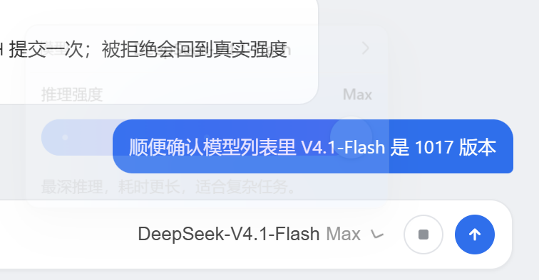
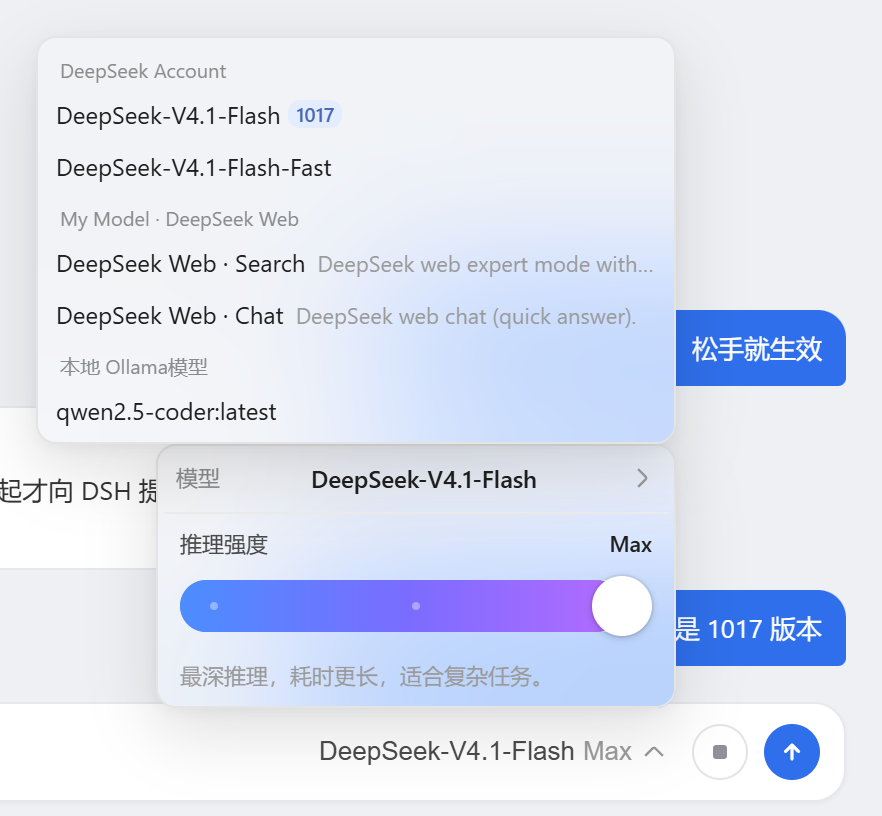

# DSH Effort Switcher

把 DSH 聊天输入区的模型座位换成「模型 + 推理强度」面板：模型列表负责换模型，滑动条负责换 `reasoningEffort`，松手即写回 DSH 的 `modelDirectories`，作用于后续请求。

## 截图

输入区座位与推理强度面板：



模型列表：名称完整显示，官方通道的 1017 版本带浅蓝角标：



## 行为

**座位替换。** 本插件以 `priority: -100` 注册 `conversation.input.model` 座位，覆盖 DSH 自带的模型选择器。触发器并排显示模型名与当前强度（如 `DeepSeek-V4.1-Flash Max`），点击弹出面板；面板底部固定展示模型行与推理强度滑块。

**滑块只提交一次。** 拖动过程中只更新本地草稿，指针抬起（或方向键 `keyup`）时才向 DSH 提交一次；被接受前滑块不会回弹，被拒绝时回到真实强度并说明原因。

**忙碌时不丢操作。** 模型切换进行中松手的操作会排队，等 DSH 空闲后自动补发；若期间模型已变，排队项按新模型丢弃，不会把旧模型的强度写到新模型上。

**模型列表按需展开。** 面板里的「模型」行打开二级浮窗，按提供方分组列出目录中的模型。名称优先占宽、描述先让位，名称不会再被自己的描述挤成省略号；行悬停有完整名称提示。

**图片兼容提示。** 草稿里已有图片时，已知纯文本模型（`deepseek-official` 通道中除视觉模型外）会在行尾显示警告图标，悬停说明原因；真正是否可用仍以 DSH 的拒绝为准，被拒绝的模型会在列表里标记为不可选。

## 要求

- DSH `0.1.0-rc.6` 或兼容版本。已在 `0.1.0-rc.6`、`0.1.2-rc.1`、`0.2.0-rc.2`、`0.2.1-alpha.2` 的 Web 端实测；桌面端（Electron + desktop profile）同样实测可用。
- 当前模型必须暴露至少一个 reasoning effort 级别。普通非推理模型不会出现滑块，面板只剩模型行。
- 触发器尺寸、字号与圆角按 DSH 0.2.x 的原生模型座位对齐；在 0.1.0-rc.6 上宿主座位同为 28px / 13px，仅字重（500 对 400）与圆角回退值略有差别。

## 安装

**Web profile**（从 GitHub 安装）：

```powershell
dsh plugin --profile web add github:haafongwai-lab/dsh-effort-switcher
```

命令会把本包装进当前 Web profile，并因 `dsh.bundle` 声明自动写入 `dsh.profile.bundles`，不必再手工编辑 profile 的 `cordis.patch.yml`。

**桌面端 profile**：`dsh plugin --profile desktop ...` 会被命令行拒绝（desktop profile 由 Electron 应用独占管理），改用应用内的插件面板安装本地目录，或在 profile 的 `package.json` 里手工加一条 `"dsh-effort-switcher": "link:<仓库绝对路径>"` 并把包名加入 `dsh.profile.bundles`。

安装后**完全退出并重新启动 DSH**，再刷新页面。DSH 只在进程启动时扫描 `dsh.client` 元数据，仅刷新旧页面或运行独立开发服务器不会加载本插件。

如果 profile 的 `cordis.patch.yml` 里还留着旧的手工挂载（`id: effort-switcher`），先删掉，避免双重挂载。

## 卸载

```powershell
dsh plugin --profile web remove dsh-effort-switcher
```

桌面端在插件面板中停用或移除。卸载后同样需要重启 DSH。

## 验证安装

在 profile 目录中运行：

```powershell
node --input-type=module -e "const plugin=await import('dsh-effort-switcher'); console.log(plugin.name)"
```

预期输出：

```text
effort-switcher
```

启动后选择一个支持 reasoning effort 的模型，输入区应显示「模型名 + 当前强度」触发器；点开后拖动滑块，DSH 会重新提交当前模型及新的 `reasoningEffort`。

## 模型角标（1017）

官方通道的 `DeepSeek-V4.1-Flash`（1017 版本）在模型列表里带一个浅蓝色 `1017` 角标。

本插件接管了整个 `conversation.input.model` 座位，官方包 `@deepseek-ai/dsh-client-ui-deepseek-model-label-1017` 挂载的 `conversation.input.model.label` 子座位因此不再渲染，角标由本插件按同一规则补上：

- 提供方为 `deepseek-official` 或 `deepseek-account`；
- 模型 ID 为 `deepseek-flash`；
- 目录名称恰好是 `DeepSeek-V4.1-Flash`。

三条同时满足才显示，`DeepSeek-V4.1-Flash-Fast` 与其他通道的同名条目保持原样。配色优先取宿主的 `--dsw-alias-state-info-*` 语义色，宿主未定义时回落到浅蓝静态色阶（`--dsw-static-deepseek-100/600`）。角标只出现在模型列表：触发器与面板的「模型」行空间有限，加角标会把刚修好的名称截断问题带回来。

官方包升级，或用结构化版本标签取代固定文案后，这段判断应同步调整。

## 项目结构

```text
index.js           Browser client module: seat, panel, slider, model list.
host.js            Minimal Cordis host entry used by DSH loader discovery.
cordis.patch.yml   Bundle patch that inserts the host plugin row.
package.json       Package exports, dsh.bundle, and dsh.client manifest.
screenshots/       README images.
verify-client.cjs  Node harness: renders the seat against a React shim and asserts behaviour.
```

## 开发

从本仓库目录把本地 checkout 链进 profile：

```powershell
dsh plugin --profile web add .
```

修改 `index.js` 后必须重启 DSH 并刷新页面，除非当前 checkout 已运行针对该客户端包的 HMR 构建监视器。

```powershell
npm run check   # 语法检查
npm test        # verify-client.cjs：座位注册、滑块提交、回滚、排队、角标、样式契约
```

`verify-client.cjs` 用最小 React 垫片渲染真实组件，不依赖浏览器；改动滑条几何、菜单布局或角标规则时，同步补断言。

## 排障

- **滑块没有显示**：确认 `dsh.profile.bundles` 中存在 `dsh-effort-switcher`，完全重启 DSH，并选用支持 reasoning effort 的模型。
- **安装后页面未更新**：DSH 的启动图已生成；停掉旧进程后重新启动。
- **显示的是官方模型选择器，像没装插件**：打开控制台，若有 `slot entry crashed in 'conversation.input.model'`，说明座位渲染崩溃后回退到官方选择器。DSH 0.1.2 起 `modelDirectories.directoryFor()` 会读取调用方上下文的 `remote.session`，插件必须声明它（否则报 `cannot get property "remote.session" without inject`）；本插件按宿主实际提供的服务自动声明，请更新到包含该修复的版本。
- **双重控件或重复挂载**：删掉 profile `cordis.patch.yml` 里旧的 `effort-switcher` insert，只保留 bundle 层。
- **拖动后未生效**：确认该模型有多个 reasoning effort 级别；只有默认强度或不支持推理的模型不会渲染滑块。
- **滑块弹回并出现红色提示**：DSH 拒绝了这次写入（会话被占用、模型不支持该强度等）。滑块回到真实强度并给出原因，再拖一次即可重试。
- **在模型切换进行中松开滑块**：该次选择会保留，等 DSH 空闲后自动提交，不会丢失。
- **滑条或滑块变成圆角方块**：DSH 0.1.2 起主题给所有元素加了 `corner-shape: superellipse(1.5)`，会把 `border-radius` 的圆画成圆角方块。本插件对滑条轨道、填充、旋钮与刻度点显式使用 `corner-shape: round`，菜单与触发器仍跟随 DSH 的圆角风格。
- **1017 角标没出现**：说明你目录项的提供方、模型 ID 或名称与官方规则不完全一致（例如 ID 不是 `deepseek-flash`）。以 `Settings → Models` 里该项的实际值为准调整 `isDeepSeek1017()` 的匹配条件。
